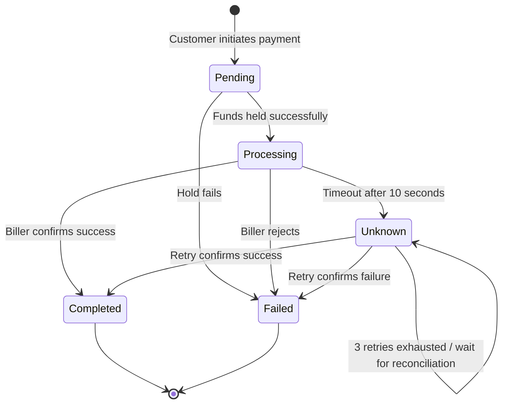

# PayLink – Requirements Document

---

## 1. Project Analysis

### 1.1 Problem Summary

**PayLink** is an Egyptian bill-payment and digital-wallet backend. Customers need to pay electricity, water, mobile top-up and internet bills through a digital wallet, either through a mobile application or an agent terminal.

The system must manage customer money accurately, communicate with different billers, prevent duplicate charges, handle failed or delayed payments, and maintain accurate financial records.

**The main engineering challenges are:**

- Preventing double charges and negative wallet balances.
- Managing payments that may fail or time out.
- Supporting different biller communication protocols.
- Calculating fees and agent commissions correctly.
- Maintaining a reliable ledger and audit trail.
- Reconciling PayLink records with biller settlement files.

### 1.2 Payment Lifecycle

| From (Current State) | Event | To (Next State) |
|:---------------------|:-------------------------------------------------|:-----------------------|
| —                    | Customer initiates payment                       | **Pending**            |
| Pending              | Wallet funds successfully held                   | **Processing**         |
| Pending              | Wallet hold fails (e.g. insufficient balance)    | **Failed**             |
| Processing           | Biller confirms successful payment               | **Completed**          |
| Processing           | Biller rejects the payment                       | **Failed**             |
| Processing           | Biller request times out after 10 seconds        | **Unknown**            |
| Unknown              | Retry confirms successful payment                | **Completed**          |
| Unknown              | Retry confirms payment failure                   | **Failed**             |
| Unknown              | All 3 retries are exhausted without confirmation | **Unknown** (wait for reconciliation) |

**State diagram:**

---

## 2. Stakeholder Identification

The following stakeholders are supported by the brief.

| Stakeholder                  | Main Responsibility                                                |
|:-----------------------------|:-------------------------------------------------------------------|
| Customer                     | Registers, manages wallet and pays bills                           |
| Agent                        | Accepts cash and pays bills for customers                          |
| Admin                        | Manages billers, services, fees and limits                         |
| Support Employee             | Searches payments and manages account blocks                       |
| Biller                       | Provides bill inquiry, receives payments and settlement information |
| Payment Service / Providers  | Supports external payment and notification interactions            |
| PayLink Management           | Defines business objectives and operational expectations           |

---

## 3. Requirements

### 3.1 Functional Requirements

| ID    | Functional Requirement                                              | Priority |
|:------|:--------------------------------------------------------------------|:---------|
| FR-1  | Customer registration with basic verification                       | Must     |
| FR-2  | Upgrade customer to verified level                                  | Should   |
| FR-3  | View available/held balance and transaction history                 | Must     |
| FR-4  | Top up wallet using simulated card or agent cash                    | Must     |
| FR-5  | Every balance change creates a ledger entry                         | Must     |
| FR-6  | Admin adds, edits and disables billers/services                     | Must     |
| FR-7  | Customer views billers and required input fields                    | Must     |
| FR-8  | Bill inquiry displays amount, fee and total                         | Must     |
| FR-9  | Customer pays a bill from wallet                                    | Must     |
| FR-10 | Idempotency prevents duplicate payments                             | Must     |
| FR-11 | Enforce the defined payment lifecycle                               | Must     |
| FR-12 | Hold funds before biller call; release on failure                   | Must     |
| FR-13 | Timeout changes payment to Unknown and triggers retries             | Must     |
| FR-14 | Accept TopUpNet callbacks and ignore duplicates                     | Must     |
| FR-15 | Support ElectroCo, AquaCo and TopUpNet                              | Must     |
| FR-16 | Calculate fees according to business rules and promotions           | Must     |
| FR-17 | Agent pays for customer and earns commission                        | Should   |
| FR-18 | Reject payments exceeding single/daily limits                       | Must     |
| FR-19 | Block account after velocity threshold                              | Should   |
| FR-20 | Support employee searches payment by reference and sees history     | Must     |
| FR-21 | Support employee blocks/unblocks account                            | Should   |
| FR-22 | Send SMS and push notification on completion/failure                | Must     |
| FR-23 | Retry failed notifications three times                              | Should   |
| FR-24 | Admin edits fees and limits without redeployment                    | Should   |
| FR-25 | Record money movements and admin actions in audit log               | Must     |
| FR-26 | Generate daily reconciliation report                                | Should   |
| FR-27 | Customer requests refund of completed payment, support approves     | Could    |
| FR-28 | Admin views daily payment, fee, commission and failure totals       | Could    |

### 3.2 Business Rules – Mandatory Values

| Rule                      | Official Value                                            |
|:--------------------------|:----------------------------------------------------------|
| Basic daily limit         | 5,000 EGP                                                 |
| Verified daily limit      | 30,000 EGP                                                |
| Single payment minimum    | 5 EGP                                                     |
| Single payment maximum    | 10,000 EGP                                                |
| Electricity/water fee     | 2.50 EGP                                                  |
| Mobile top-up fee         | 1.5%, minimum 1 EGP                                       |
| Internet fee              | 2 EGP up to 200 EGP; 4 EGP above 200 EGP                  |
| Promotion                 | Zero fee for one configured biller during configured dates |
| Agent commission          | 40% of service fee                                        |
| Velocity                  | More than 5 payments in 60 seconds; block for 10 minutes  |
| Live biller timeout       | 10 seconds                                                |
| Unknown retries           | After 1, 5 and 15 minutes; maximum 3 retries              |
| Notification retries      | 3 retries, then undelivered                               |
| Money calculations        | Exact decimal types, never floating point                 |

### 3.3 Mandatory Hard Cases

| ID    | Hard Case                                                         | Required Outcome                                    |
|:------|:------------------------------------------------------------------|:----------------------------------------------------|
| HC-01 | Duplicate payment request                                         | One payment and one charge                          |
| HC-02 | ElectroCo responds after 12 seconds                               | Unknown; funds remain held                          |
| HC-03 | AquaCo refuses payment                                            | Failed, hold released, SMS with reason              |
| HC-04 | Two simultaneous payments with insufficient combined balance      | Only one succeeds; balance never negative           |
| HC-05 | SMS provider unavailable                                          | Payment completes independently; notification retries |
| HC-06 | Duplicate TopUpNet success callback                               | One completion; duplicate ignored and logged        |
| HC-07 | Settlement file disagrees with payment record                     | Flag discrepancy in report                          |
| HC-08 | Add new biller                                                    | New integration and configuration only              |

---

## 4. Non-Functional Requirements

| ID     | Quality         | Official Acceptance Target                                                                                                                                                                  |
|:-------|:----------------|:--------------------------------------------------------------------------------------------------------------------------------------------------------------------------------------------|
| NFR-01 | Correctness     | Zero double charges and zero negative balances in duplicate/concurrency tests                                                                                                               |
| NFR-02 | Performance     | 100 payments/second sustained for one minute against mock billers                                                                                                                           |
| NFR-03 | Resilience      | Outage of one biller must not stop payments to other billers                                                                                                                                |
| NFR-04 | Modifiability   | Adding a biller changes only Biller Integration and configuration                                                                                                                           |
| NFR-05 | Auditability    | 100% of money movements have audit records with who, when and why                                                                                                                           |
| NFR-06 | Testability     | At least 70% line coverage on domain logic, measured in CI                                                                                                                                  |
| NFR-07 | Security        | The system shall protect user data and financial information against unauthorized access, disclosure, modification, and misuse through appropriate authentication, authorization, and data protection mechanisms. |
| NFR-08 | Availability    | The system shall remain available and accessible to authorized users during its intended operating hours, with minimal downtime and reliable recovery from unexpected failures.            |
| NFR-09 | Usability       | The system shall provide a user-friendly, intuitive, and consistent interface that enables customers, agents, and administrators to use its features easily and complete their tasks with minimal effort and confusion. |

---

## 5. User Stories

| ID     | Title                        | User Story                                                                                                                                    |
|:-------|:-----------------------------|:----------------------------------------------------------------------------------------------------------------------------------------------|
| US-001 | Customer Registration        | As a new customer, I want to register with PayLink, so that I can access wallet and bill-payment services.                                    |
| US-002 | Verification Upgrade         | As a customer, I want to upgrade my verification level, so that I can access a higher daily payment limit.                                    |
| US-003 | Wallet Balance               | As a customer, I want to view my available and held wallet balance, so that I know how much money I can spend.                                |
| US-004 | Transaction History          | As a customer, I want to view my transaction history, so that I can track my financial activity.                                              |
| US-005 | Wallet Top-up                | As a customer, I want to top up my wallet using a simulated card or agent cash, so that I can fund bill payments.                             |
| US-006 | Ledger Transparency          | As a system auditor, I want every wallet balance change recorded in a ledger, so that financial movements can be traced.                      |
| US-007 | Biller Management            | As an administrator, I want to add, edit and disable billers and their services, so that the available services remain manageable.            |
| US-008 | Biller Discovery             | As a customer, I want to browse billers and their required input fields, so that I can provide the correct information.                       |
| US-009 | Bill Inquiry                 | As a customer, I want to retrieve my outstanding bill, so that I know the amount due before paying.                                           |
| US-010 | Fee Transparency             | As a customer, I want to see the service fee and total payment amount, so that I know the complete cost.                                      |
| US-011 | Wallet Bill Payment          | As a customer, I want to pay a bill using my wallet, so that I can settle utility bills conveniently.                                         |
| US-012 | Idempotent Payment           | As a customer, I want repeated payment requests to return the original result, so that network retries do not charge me twice.                |
| US-013 | Payment Lifecycle            | As a payment processing system, I want to enforce the approved payment states, so that invalid state transitions cannot occur.                |
| US-014 | Funds Hold and Release       | As a customer, I want funds to be held before biller processing and released after confirmed failure, so that my wallet remains accurate.     |
| US-015 | Timeout and Retry            | As a payment system, I want to retry Unknown payments according to the configured schedule, so that delayed biller responses can be resolved. |
| US-016 | Multiple Biller Integrations | As PayLink, I want to integrate with ElectroCo, AquaCo and TopUpNet through separate adapters, so that different protocols are handled consistently. |
| US-017 | Asynchronous Callbacks       | As a payment system, I want to process TopUpNet callbacks and ignore duplicate callbacks, so that a payment is completed only once.           |
| US-018 | Fee Calculation              | As PayLink, I want to calculate fees using the configured fixed, percentage, tiered and promotional rules, so that customers are charged correctly. |
| US-019 | Agent Commission             | As an agent, I want to receive 40% of the service fee for eligible completed payments, so that my commission is calculated correctly.        |
| US-020 | Fraud and Limits             | As a payment system, I want to enforce daily payment limits and velocity rules, so that suspicious or excessive payment activity is blocked.  |
| US-021 | Support Payment Search       | As a support employee, I want to search payments by reference and inspect their full history, so that I can investigate customer issues.     |
| US-022 | Account Blocking             | As a support employee, I want to block and unblock customer accounts, so that compromised or suspicious accounts can be controlled.          |
| US-023 | Customer Notifications       | As a customer, I want to receive SMS and push notifications when a payment completes or fails, so that I know the payment outcome.            |
| US-024 | Notification Retry           | As a notification service, I want to retry failed SMS or email messages three times and mark them undelivered afterward, so that delivery failures are tracked. |
| US-025 | Audit and Configuration      | As an administrator, I want to modify fee and limit values without redeployment and have administrative actions audited, so that business rules remain configurable and traceable. |
| US-026 | Reconciliation and Reporting | As a support employee, I want to review daily reconciliation differences and payment totals, so that I can identify financial discrepancies and monitor operations. |
| US-027 | Refund Management            | As a customer, I want to request a refund for a completed payment, so that support can review and approve eligible refunds.                   |

---

## 5.1 User Stories – Acceptance Criteria

### US-001 – Customer Registration

> As a new customer, I want to register with PayLink, so that I can access wallet and bill-payment services.

**Acceptance Criteria:**

1. The system shall allow a new customer to create an account.
2. The system shall collect the required registration information.
3. The system shall validate all mandatory registration fields.
4. The system shall reject registration if the customer already has an account.
5. The system shall assign the customer the Basic verification level after successful registration.
6. The system shall create a wallet associated with the registered customer.
7. The system shall prevent unauthorized users from accessing the customer's account.

### US-002 – Verification Upgrade

> As a customer, I want to upgrade my verification level, so that I can access a higher daily payment limit.

**Acceptance Criteria:**

1. The system shall allow Basic customers to request a verification upgrade.
2. The system shall process the verification upgrade according to the configured verification workflow.
3. The system shall upgrade the customer's status only after successful verification approval.
4. The system shall apply a daily payment limit of 5,000 EGP to Basic customers.
5. The system shall apply a daily payment limit of 30,000 EGP to Verified customers.
6. The system shall prevent customers from using the Verified limit before their upgrade is approved.

### US-003 – Wallet Balance

> As a customer, I want to view my available and held wallet balance, so that I know how much money I can spend.

**Acceptance Criteria:**

1. The system shall display the customer's current available wallet balance.
2. The system shall display the customer's current held wallet balance separately.
3. The available balance shall represent funds that the customer can spend.
4. The held balance shall represent funds reserved for payments that are still being processed.
5. The system shall update the displayed balances after successful wallet transactions.
6. The system shall ensure that the available wallet balance never becomes negative.

### US-004 – Transaction History

> As a customer, I want to view my transaction history, so that I can track my financial activity.

**Acceptance Criteria:**

1. The system shall display the customer's wallet transaction history.
2. The history shall include successful, failed and pending payment transactions.
3. Each transaction shall display its unique reference number.
4. Each transaction shall display its amount, date and current status.
5. The system shall display applicable service fees.
6. The system shall ensure that customers can access only their own transaction history.

### US-005 – Wallet Top-up

> As a customer, I want to top up my wallet using a simulated card or agent cash, so that I can fund bill payments.

**Acceptance Criteria:**

1. The system shall support wallet top-up using a simulated card.
2. The system shall support wallet top-up through an authorized agent.
3. The system shall increase the customer's available balance after a successful top-up.
4. The system shall reject unsuccessful top-up requests without increasing the wallet balance.
5. Every successful top-up shall generate a corresponding ledger entry.
6. The system shall record the top-up amount, reference and transaction details.
7. The system shall prevent duplicate top-up processing.

### US-006 – Ledger Transparency

> As a system auditor, I want every wallet balance change recorded in a ledger, so that financial movements can be traced.

**Acceptance Criteria:**

1. The system shall create a ledger entry for every wallet balance change.
2. Ledger entries shall record the transaction reference.
3. Each entry shall contain the amount and transaction type.
4. Each entry shall record the transaction timestamp.
5. Each entry shall identify the reason for the financial movement.
6. The system shall maintain a complete and traceable financial record.
7. The system shall use exact decimal types for monetary calculations and shall never use floating-point arithmetic.
8. The system shall maintain audit records for 100% of money movements.

### US-007 – Biller Management

> As an administrator, I want to add, edit and disable billers and their services, so that the available services remain manageable.

**Acceptance Criteria:**

1. The system shall allow authorized administrators to add new billers.
2. The system shall allow administrators to edit existing biller information.
3. The system shall allow administrators to disable existing billers.
4. The system shall allow administrators to add and edit biller services.
5. The system shall prevent disabled billers from receiving new payment requests.
6. The system shall record administrative changes in the audit log.
7. The system shall allow new biller integrations through separate adapters and configuration without modifying unrelated payment logic.

### US-008 – Biller Discovery

> As a customer, I want to browse billers and their required input fields, so that I can provide the correct information.

**Acceptance Criteria:**

1. The system shall display the available billers.
2. The system shall display the services provided by each biller.
3. The system shall display the required input fields for each service.
4. The system shall identify mandatory input fields.
5. The system shall validate that customers provide the required information before submitting a bill inquiry.
6. The system shall not display disabled billers as available services.

### US-009 – Bill Inquiry

> As a customer, I want to retrieve my outstanding bill, so that I know the amount due before paying.

**Acceptance Criteria:**

1. The system shall allow customers to submit the required bill information.
2. The system shall send the inquiry request to the selected biller.
3. The system shall retrieve and display the outstanding bill amount when the biller responds successfully.
4. The system shall display the biller and service information associated with the inquiry.
5. The system shall not initiate a payment automatically after a successful inquiry.
6. The system shall display an appropriate error if the biller rejects the inquiry or returns an unsuccessful response.

> **Open point:** The exact behavior for inquiry timeouts and failures is not defined in the project brief and requires clarification (see AQ-05).

### US-010 – Fee Transparency

> As a customer, I want to see the service fee and total payment amount, so that I know the complete cost.

**Acceptance Criteria:**

1. The system shall calculate the applicable service fee before payment confirmation.
2. The system shall display the original bill amount.
3. The system shall display the service fee separately.
4. The system shall display the total payment amount, including the service fee.
5. The system shall apply the configured fee rules for the selected service.
6. The system shall apply eligible promotional discounts.
7. The system shall not proceed with payment until the customer can review the total amount.

### US-011 – Wallet Bill Payment

> As a customer, I want to pay a bill using my wallet, so that I can settle utility bills conveniently.

**Acceptance Criteria:**

1. The system shall allow customers to initiate a bill payment using their wallet.
2. The system shall verify that the customer has sufficient available balance.
3. The system shall reject payments below 5 EGP.
4. The system shall reject payments above 10,000 EGP.
5. The system shall verify the customer's daily payment limit.
6. The system shall hold the required funds before sending the payment request to the biller.
7. The system shall update the payment status according to the approved payment lifecycle.
8. The system shall deduct the held funds after the biller confirms successful payment.
9. The system shall release held funds after confirmed payment failure.

### US-012 – Idempotent Payment

> As a customer, I want repeated payment requests to return the original result, so that network retries do not charge me twice.

**Acceptance Criteria:**

1. The system shall require a unique idempotency key for each payment request.
2. The system shall identify repeated requests using the same idempotency key.
3. The system shall process a payment request only once.
4. The system shall return the original payment result when the same request is submitted again.
5. The system shall not create another wallet deduction for duplicate requests.
6. The system shall not send duplicate biller payment requests for the same payment.
7. The system shall maintain one payment record and one corresponding financial charge for duplicate requests.

> **Related Hard Case:** HC-01 – Duplicate payment request must result in one payment and one charge.

### US-013 – Payment Lifecycle

> As a payment processing system, I want to enforce the approved payment states, so that invalid state transitions cannot occur.

**Acceptance Criteria:**

1. The system shall create a new payment with the Pending status.
2. The system shall change the payment status from Pending to Processing after successfully holding the required wallet funds.
3. The system shall change the payment status from Pending to Failed if the wallet hold fails.
4. The system shall change the payment status from Processing to Completed when the biller confirms successful payment.
5. The system shall change the payment status from Processing to Failed when the biller rejects the payment.
6. The system shall change the payment status from Processing to Unknown if the biller does not respond within 10 seconds.
7. The system shall allow an Unknown payment to become Completed when a retry confirms success.
8. The system shall allow an Unknown payment to become Failed when a retry confirms failure.
9. The system shall keep the payment in Unknown status if all three retries are exhausted without confirmation.
10. The system shall reject any state transition that is not defined in the approved payment lifecycle.

### US-014 – Funds Hold and Release

> As a customer, I want funds to be held before biller processing and released after confirmed failure, so that my wallet remains accurate.

**Acceptance Criteria:**

1. The system shall verify sufficient available wallet balance before placing a hold.
2. The system shall move the required amount from available balance to held balance before processing the biller payment.
3. The system shall prevent held funds from being spent in another transaction.
4. The system shall maintain the hold while the payment is in Processing status.
5. The system shall keep the funds held when the payment becomes Unknown.
6. The system shall deduct the held amount after confirmed successful payment.
7. The system shall release the held amount back to the available balance after confirmed payment failure.
8. The system shall ensure that the same hold cannot be released or deducted more than once.
9. The system shall ensure that simultaneous payment requests cannot cause the wallet balance to become negative.

> **Related Hard Cases:**
>
> - HC-02 – ElectroCo responds after 12 seconds.
> - HC-03 – AquaCo refuses payment.
> - HC-04 – Two simultaneous payments with insufficient combined balance.

### US-015 – Timeout and Retry

> As a payment system, I want to retry Unknown payments according to the configured schedule, so that delayed biller responses can be resolved.

**Acceptance Criteria:**

1. The system shall change a payment to Unknown if the biller does not respond within 10 seconds.
2. The system shall schedule the first retry after 1 minute.
3. The system shall schedule the second retry after 5 minutes.
4. The system shall schedule the third retry after 15 minutes.
5. The system shall perform a maximum of three retries for each Unknown payment.
6. The system shall update the payment to Completed if a retry confirms successful payment.
7. The system shall update the payment to Failed if a retry confirms payment failure.
8. The system shall keep the payment in Unknown status if all three retries finish without confirmation.
9. The system shall keep the wallet funds held while the payment remains Unknown.
10. The system shall wait for reconciliation when all retries are exhausted without a confirmed result.

### US-016 – Multiple Biller Integrations

> As PayLink, I want to integrate with ElectroCo, AquaCo and TopUpNet through separate adapters, so that different protocols are handled consistently.

**Acceptance Criteria:**

1. The system shall support integration with ElectroCo.
2. The system shall support integration with AquaCo.
3. The system shall support integration with TopUpNet.
4. The system shall implement a separate adapter for each biller.
5. Each adapter shall handle communication according to its biller's protocol.
6. The system shall provide a consistent internal payment interface for all biller adapters.
7. The failure of one biller integration shall not prevent payments to other billers.
8. Adding a new biller shall require changes only to the Biller Integration component and its configuration, without modifying unrelated business logic.

> **Related Hard Case:** HC-08 – Adding a new biller through a new integration and configuration only.

### US-017 – Asynchronous Callbacks

> As a payment system, I want to process TopUpNet callbacks and ignore duplicate callbacks, so that a payment is completed only once.

**Acceptance Criteria:**

1. The system shall accept asynchronous payment callbacks from TopUpNet.
2. The system shall identify the payment associated with each callback.
3. The system shall process a valid success callback and update the payment to Completed.
4. The system shall process a valid failure callback and update the payment to Failed.
5. The system shall ignore duplicate callbacks for an already processed payment result.
6. The system shall prevent duplicate wallet deductions resulting from repeated callbacks.
7. The system shall record duplicate callbacks in the system logs.
8. The system shall ensure that callback processing does not cause invalid payment state transitions.

> **Related Hard Case:** HC-06 – Duplicate TopUpNet success callback.
>
> **Open point:** Callback authentication requirements are not specified in the brief (AQ-09).

### US-018 – Fee Calculation

> As PayLink, I want to calculate fees using the configured fixed, percentage, tiered and promotional rules, so that customers are charged correctly.

**Acceptance Criteria:**

1. The system shall support fixed service fees.
2. The system shall support percentage-based service fees.
3. The system shall support tiered service fees.
4. The system shall support promotional fee rules.
5. The system shall charge a fixed fee of 2.50 EGP for electricity and water payments.
6. The system shall charge a mobile top-up fee of 1.5% of the transaction amount, with a minimum fee of 1 EGP.
7. The system shall charge an internet fee of 2 EGP for amounts up to and including 200 EGP.
8. The system shall charge an internet fee of 4 EGP for amounts above 200 EGP.
9. The system shall apply a zero-fee promotion for the configured biller during the configured promotional dates.
10. The system shall calculate monetary values using exact decimal types rather than floating-point arithmetic.
11. The system shall display the calculated fee and total payment amount before payment confirmation.

### US-019 – Agent Commission

> As an agent, I want to receive 40% of the service fee for eligible completed payments, so that my commission is calculated correctly.

**Acceptance Criteria:**

1. The system shall identify payments performed through an agent.
2. The system shall calculate agent commission as 40% of the applicable service fee.
3. The system shall calculate commission only for eligible completed payments.
4. The system shall not award commission for failed payments.
5. The system shall not award commission for payments that remain Pending, Processing or Unknown.
6. The system shall calculate commission using exact decimal arithmetic.
7. The system shall record the commission amount and its associated payment reference.
8. The system shall prevent duplicate commission calculations for the same payment.

### US-020 – Fraud and Limits

> As a payment system, I want to enforce daily payment limits and velocity rules, so that suspicious or excessive payment activity is blocked.

**Acceptance Criteria:**

1. The system shall enforce a daily payment limit of 5,000 EGP for Basic customers.
2. The system shall enforce a daily payment limit of 30,000 EGP for Verified customers.
3. The system shall reject payments that exceed the customer's applicable daily limit.
4. The system shall reject individual payments below 5 EGP.
5. The system shall reject individual payments above 10,000 EGP.
6. The system shall monitor the number of payments made within a 60-second period.
7. The system shall detect when a customer makes more than five payments within 60 seconds.
8. The system shall block the customer's payment activity for 10 minutes after exceeding the velocity threshold.
9. The system shall prevent blocked customers from initiating new payments during the blocking period.
10. The system shall restore payment access after the 10-minute blocking period expires.

### US-021 – Support Payment Search

> As a support employee, I want to search payments by reference and inspect their full history, so that I can investigate customer issues.

**Acceptance Criteria:**

1. The system shall allow authorized support employees to search for payments using their unique reference numbers.
2. The system shall display the payment details matching the entered reference.
3. The system shall display the payment amount and applicable service fee.
4. The system shall display the payment's current status.
5. The system shall display the payment creation date and relevant timestamps.
6. The system shall display the payment's status transition history.
7. The system shall display related wallet movements and payment processing records.
8. The system shall display an appropriate message when no payment matches the provided reference.

### US-022 – Account Blocking

> As a support employee, I want to block and unblock customer accounts, so that compromised or suspicious accounts can be controlled.

**Acceptance Criteria:**

1. The system shall allow authorized support employees to block customer accounts.
2. The system shall allow authorized support employees to unblock previously blocked accounts.
3. The system shall prevent blocked customers from initiating new payment transactions.
4. The system shall prevent unauthorized employees from blocking or unblocking accounts.
5. The system shall record every account-blocking action in the audit log.
6. The system shall record the employee responsible for the action.
7. The system shall record the date and time of the action.
8. The system shall record the reason for blocking or unblocking the account.

> **Open point:** The handling of payments already in progress when an account is blocked requires clarification (AQ-10).

### US-023 – Customer Notifications

> As a customer, I want to receive SMS and push notifications when a payment completes or fails, so that I know the payment outcome.

**Acceptance Criteria:**

1. The system shall send an SMS notification when a payment is completed successfully.
2. The system shall send a push notification when a payment is completed successfully.
3. The system shall send an SMS notification when a payment fails.
4. The system shall send a push notification when a payment fails.
5. The notification shall include the payment reference.
6. The notification shall communicate the final payment outcome.
7. The system shall include the failure reason when it is available.
8. The notification service shall operate independently of the payment processing service.
9. A notification provider failure shall not change the actual payment status.

> **Related Hard Case:** HC-05 – SMS provider unavailable. Payment must complete independently while notification retries are performed.

### US-024 – Notification Retry

> As a notification service, I want to retry failed SMS or email messages three times and mark them undelivered afterward, so that delivery failures are tracked.

**Acceptance Criteria:**

1. The system shall detect unsuccessful notification delivery attempts.
2. The system shall retry sending a failed notification up to three times.
3. The system shall stop retrying after three unsuccessful attempts.
4. The system shall mark the notification as Undelivered after all three retries fail.
5. The system shall maintain the notification delivery status.
6. The system shall record the number of delivery attempts.
7. The system shall record notification delivery failures.
8. The system shall ensure that notification failures do not reverse or modify completed payments.

### US-025 – Audit and Configuration

> As an administrator, I want to modify fee and limit values without redeployment and have administrative actions audited, so that business rules remain configurable and traceable.

**Acceptance Criteria:**

1. The system shall allow authorized administrators to modify service fee configurations.
2. The system shall allow authorized administrators to modify customer payment limits.
3. The system shall allow configuration changes without redeploying the application.
4. The system shall apply updated configurations to subsequent eligible transactions.
5. The system shall record every administrative configuration change in the audit log.
6. Each audit record shall identify the administrator who performed the action.
7. Each audit record shall contain the date and time of the action.
8. Each audit record shall identify the modified configuration.
9. The system shall maintain a traceable history of administrative actions.
10. The system shall prevent unauthorized users from modifying business configurations.

### US-026 – Reconciliation and Reporting

> As a support employee, I want to review daily reconciliation differences and payment totals, so that I can identify financial discrepancies and monitor operations.

**Acceptance Criteria:**

1. The system shall generate a daily reconciliation report.
2. The system shall compare PayLink payment records with biller settlement information.
3. The system shall identify differences between PayLink records and biller settlement files.
4. The system shall flag discrepancies in the reconciliation report.
5. The system shall provide payment totals for the reporting period.
6. The system shall identify payments that remain in Unknown status and require reconciliation.
7. The system shall provide sufficient transaction references to investigate identified discrepancies.
8. The system shall maintain reconciliation results for operational review.

> **Related Hard Case:** HC-07 – Settlement file disagrees with payment record; the system must flag the discrepancy in the report.

### US-027 – Refund Management

> As a customer, I want to request a refund for a completed payment, so that support can review and approve eligible refunds.

**Acceptance Criteria:**

1. The system shall allow customers to submit refund requests for completed payments.
2. The system shall require a valid payment reference for each refund request.
3. The system shall verify that the referenced payment exists.
4. The system shall verify that the referenced payment has Completed status.
5. The system shall prevent customers from requesting refunds for failed or incomplete payments.
6. The system shall record each refund request and its associated payment reference.
7. The system shall allow authorized support employees to review refund requests.
8. The system shall allow authorized support employees to approve or reject refund requests.
9. The system shall process an approved refund according to the configured refund workflow.
10. The system shall record the refund transaction in the financial ledger.
11. The system shall prevent the same payment from being refunded more than once.
12. The system shall maintain the refund request status for tracking and investigation.

> **Open point:** The exact refund processing method, approval authorization and ledger treatment are not defined in the project brief (AQ-07 and AQ-12).

---

## 6. AI Questions & Ambiguities

| ID    | Question                                                                  | Why It Matters                 |
|:------|:--------------------------------------------------------------------------|:-------------------------------|
| AQ-01 | What information is required during customer registration?                | Account data model             |
| AQ-02 | How is basic-to-verified upgrade approved?                                | Verification workflow          |
| AQ-03 | What are the simulated card top-up rules?                                 | Wallet funding                 |
| AQ-04 | How is an agent identified and authenticated?                             | Agent operations               |
| AQ-05 | What happens when a bill inquiry fails?                                   | Customer experience            |
| AQ-06 | What happens if the bill amount changes between inquiry and payment?      | Financial correctness          |
| AQ-07 | How are completed payment refunds processed and recorded?                 | Refund workflow                |
| AQ-08 | What happens when a biller does not respond after all three retries?      | Unknown payment resolution     |
| AQ-09 | How are callback requests authenticated?                                  | Integration security           |
| AQ-10 | What happens when an account is blocked during an existing payment?       | Account/payment consistency    |
| AQ-11 | Which timezone defines daily limits and reconciliation?                   | Date calculations              |
| AQ-12 | How are support refund approvals authorized and audited?                  | Financial authorization        |