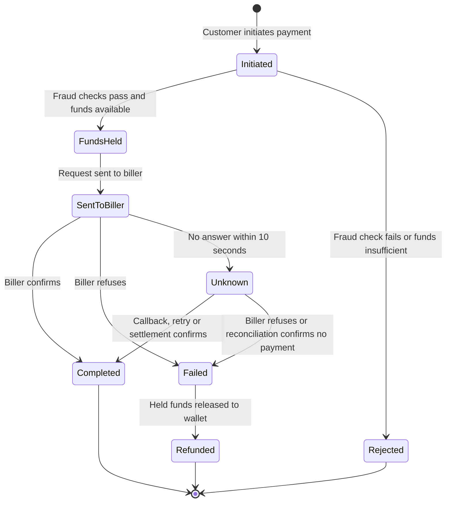

# PayLink – Requirements Document

---

## 1. Project Analysis

### 1.1 Problem Summary

**PayLink** is an Egyptian digital-wallet and bill-payment backend that lets customers settle electricity, water, mobile top-up and internet bills from a wallet, either directly through the mobile application or with help from an agent using a PayLink terminal.

PayLink must protect customer funds throughout each payment, apply the defined limits and service fees, communicate with billers that use different protocols, prevent duplicate charges, and keep its ledger, audit trail and reconciliation records consistent. The main challenge is to resolve delayed or failed biller responses without charging a customer twice or returning money before the biller's outcome is known.

**The main engineering challenges are:**

- Preventing double charges and negative wallet balances.
- Managing payments that may fail or time out.
- Supporting different biller communication protocols.
- Calculating fees and agent commissions correctly.
- Maintaining a reliable ledger and audit trail.
- Reconciling PayLink records with biller settlement files.

### 1.2 Payment Lifecycle

Every payment is in exactly one official state. The system must permit only the transitions below, as specified in Section 2.5 of the Student Brief.

| From (Current State) | Event | To (Next State) |
|:---------------------|:------|:----------------|
| — | Customer initiates payment | **Initiated** |
| Initiated | Fraud checks pass and wallet has sufficient available funds | **FundsHeld** |
| Initiated | Fraud check fails or funds are insufficient | **Rejected** |
| FundsHeld | Payment request is sent to the biller | **SentToBiller** |
| SentToBiller | Biller confirms successful payment | **Completed** |
| SentToBiller | Biller refuses the payment | **Failed** |
| SentToBiller | No answer within the 10-second live-biller timeout | **Unknown** |
| Unknown | Biller later confirms through callback, retry or settlement file | **Completed** |
| Unknown | Biller later refuses, or reconciliation confirms that no payment occurred | **Failed** |
| Failed | The held amount is released back to the wallet | **Refunded** |

**State rules:**

- `Completed`, `Rejected` and `Refunded` are final states.
- A payment in `Unknown` keeps its funds held. It must never be refunded automatically; funds are returned only after the system has definitive evidence that the biller did not receive the payment.
- Unknown-payment retry attempts are scheduled 1 minute, 5 minutes and 15 minutes after the payment first enters `Unknown` (three retry attempts in total). If all retries finish without a confirmed result, no state transition occurs: the payment remains `Unknown` and waits for reconciliation.
- A confirmed failure releases the hold exactly once and changes `Failed` to `Refunded`. `Rejected` occurs before funds are held and therefore does not require a hold release.

**State diagram:**

---

## 2. Stakeholder Identification

The following stakeholders are supported by the brief.

| Stakeholder                  | Main Responsibility                                                |
|:-----------------------------|:-------------------------------------------------------------------|
| Customer                     | Registers, manages wallet and pays bills                           |
| Agent                        | Accepts cash and pays bills for customers                          |
| Admin                        | Manages billers, services, fees and limits                         |
| Support Employee             | Searches payments and manages account blocks                       |
| Biller                       | Provides bill inquiry, receives payments and settlement information |
| Payment Service / Providers  | External providers used for simulated card top-ups and SMS, push or email delivery; availability failures must not corrupt payment outcomes |
| NetCo                         | Optional internet-bill integration using a daily Payments CSV upload and a Result File returned the next morning |
| PayLink Management           | Defines business objectives and operational expectations           |

---

## 3. Requirements

### 3.1 Functional Requirements

| ID    | Functional Requirement                                              | Priority |
|:------|:--------------------------------------------------------------------|:---------|
| FR-1  | Customer registration with basic verification                       | Must     |
| FR-2  | Upgrade customer to verified level                                  | Should   |
| FR-3  | View available/held balance and transaction history                 | Must     |
| FR-4  | Top up wallet using simulated card or agent cash                    | Must     |
| FR-5  | Every balance change creates a ledger entry                         | Must     |
| FR-6  | Admin adds, edits and disables billers/services                     | Must     |
| FR-7  | Customer views billers and required input fields                    | Must     |
| FR-8  | Bill inquiry displays amount, fee and total                         | Must     |
| FR-9  | Customer pays a bill from wallet                                    | Must     |
| FR-10 | Idempotency prevents duplicate payments                             | Must     |
| FR-11 | Enforce the defined payment lifecycle                               | Must     |
| FR-12 | Hold funds before biller call; release on failure                   | Must     |
| FR-13 | Timeout changes payment to Unknown and triggers retries             | Must     |
| FR-14 | Accept TopUpNet callbacks and ignore duplicates                     | Must     |
| FR-15 | Support at least three mock billers (ElectroCo, AquaCo and TopUpNet); NetCo batch is optional | Must |
| FR-16 | Calculate fees according to business rules and promotions           | Must     |
| FR-17 | Agent pays for customer and earns commission                        | Should   |
| FR-18 | Reject payments exceeding single/daily limits                       | Must     |
| FR-19 | Block account after velocity threshold                              | Should   |
| FR-20 | Support employee searches payment by reference and sees history     | Must     |
| FR-21 | Support employee blocks/unblocks account                            | Should   |
| FR-22 | Send SMS and push notification on completion/failure                | Must     |
| FR-23 | Retry failed notifications up to three times (SMS/email explicitly specified in the business rules; push retry scope to confirm) | Should |
| FR-24 | Admin edits fees and limits without redeployment                    | Should   |
| FR-25 | Record money movements and admin actions in audit log               | Must     |
| FR-26 | Generate daily reconciliation report                                | Should   |
| FR-27 | Customer requests refund of completed payment, support approves     | Could    |
| FR-28 | Admin views daily payment, fee, commission and failure totals       | Could    |

### 3.1.1 Biller Integration Scope

| Biller | Service | Protocol / Interaction | Required behaviour and scope |
|:-------|:--------|:-----------------------|:-----------------------------|
| ElectroCo | Electricity | REST, JSON; live inquiry and payment | Fast response (under 1 second); payment is confirmed immediately. Required mock biller. |
| AquaCo | Water | SOAP-style XML over HTTP | Slower response (2–4 seconds), different field names and error codes; rejects payments above the bill amount. Required mock biller. |
| TopUpNet | Mobile top-up | REST, JSON, asynchronous callback | Initially replies `accepted`, then calls PayLink's callback URL minutes later with `success` or `failed`. Required mock biller. |
| NetCo | Internet | Daily batch CSV; no live inquiry | PayLink uploads a Payments file once per day; NetCo returns a Result File the next morning. The result file feeds reconciliation and can resolve matching `Unknown` payments to `Completed` or `Failed`. |

**Scope decision:** Phase 2 implementation must include at least the three required mock billers: ElectroCo, AquaCo and TopUpNet. NetCo batch processing is explicitly optional under FR-15, so it is documented as an optional integration and is not part of the mandatory three-mock-biller implementation unless the team and TA agree to include it. The reconciliation design must nevertheless recognise settlement/result-file evidence as a valid way to resolve `Unknown` payments, as required by the lifecycle.

### 3.2 Business Rules – Mandatory Values

| Rule                      | Official Value                                            |
|:--------------------------|:----------------------------------------------------------|
| Basic daily limit         | 5,000 EGP                                                 |
| Verified daily limit      | 30,000 EGP                                                |
| Single payment minimum    | 5 EGP                                                     |
| Single payment maximum    | 10,000 EGP                                                |
| Electricity/water fee     | 2.50 EGP                                                  |
| Mobile top-up fee         | 1.5%, minimum 1 EGP                                       |
| Internet fee              | 2 EGP up to 200 EGP; 4 EGP above 200 EGP                  |
| Promotion                 | Zero fee for one configured biller during configured dates |
| Agent commission          | 40% of service fee                                        |
| Velocity                  | More than 5 payment attempts in 60 seconds; block new payment attempts for 10 minutes |
| Live biller timeout       | 10 seconds                                                |
| Unknown retries           | After 1, 5 and 15 minutes; maximum 3 retries              |
| Notification retries      | Failed SMS or email: 3 retries, then undelivered; push retry scope requires clarification |
| Money calculations        | Exact decimal types, never floating point                 |

### 3.3 Mandatory Hard Cases

| ID    | Hard Case                                                         | Required Outcome                                    |
|:------|:------------------------------------------------------------------|:----------------------------------------------------|
| HC-01 | Duplicate payment request                                         | One payment and one charge                          |
| HC-02 | ElectroCo responds after 12 seconds                               | Unknown; funds remain held                          |
| HC-03 | AquaCo refuses payment                                            | Failed, hold released, SMS with reason              |
| HC-04 | Two simultaneous payments with insufficient combined balance      | Only one succeeds; balance never negative           |
| HC-05 | SMS provider unavailable                                          | Payment completes independently; notification retries |
| HC-06 | Duplicate TopUpNet success callback                               | One completion; duplicate ignored and logged        |
| HC-07 | Settlement file disagrees with payment record                     | Flag discrepancy in report                          |
| HC-08 | Add new biller                                                    | New integration and configuration only              |

**Hard-case traceability:** HC-01 → US-012; HC-02 → US-014/US-015; HC-03 → US-014/US-023; HC-04 → US-014/US-020; HC-05 → US-023/US-024; HC-06 → US-017; HC-07 → US-015/US-026; HC-08 → US-007/US-016. Each case must have at least one automated test, as required by the Student Brief.

---

### 3.4 Requirements Traceability (FR → US → Hard Case)

| Functional Requirement | Related User Story | Related Hard Case |
|:-----------------------|:-------------------|:------------------|
| FR-1 | US-001 | — |
| FR-2 | US-002 | — |
| FR-3 | US-003, US-004 | — |
| FR-4 | US-005 | — |
| FR-5 | US-006 | — |
| FR-6 | US-007 | HC-08 |
| FR-7 | US-008 | — |
| FR-8 | US-009, US-010 | — |
| FR-9 | US-011 | — |
| FR-10 | US-012 | HC-01 |
| FR-11 | US-013 | HC-02, HC-03 |
| FR-12 | US-014 | HC-02, HC-03, HC-04 |
| FR-13 | US-015 | HC-02, HC-07 |
| FR-14 | US-017 | HC-06 |
| FR-15 | US-016 | HC-08 |
| FR-16 | US-018 | — |
| FR-17 | US-019 | — |
| FR-18 | US-011, US-020 | HC-04 |
| FR-19 | US-020 | HC-04 |
| FR-20 | US-021 | — |
| FR-21 | US-022 | — |
| FR-22 | US-023 | HC-03, HC-05 |
| FR-23 | US-024 | HC-05 |
| FR-24 | US-025 | — |
| FR-25 | US-006, US-025 | — |
| FR-26 | US-026 | HC-07 |
| FR-27 | US-027 | — |
| FR-28 | US-028 | — |

## 4. Non-Functional Requirements

| ID     | Quality         | Acceptance Target / Status                                                                                                                                                                   |
|:-------|:----------------|:--------------------------------------------------------------------------------------------------------------------------------------------------------------------------------------------|
| NFR-01 | Correctness     | Zero double charges and zero negative balances in duplicate/concurrency tests                                                                                                               |
| NFR-02 | Performance     | 100 payments/second sustained for one minute against mock billers                                                                                                                           |
| NFR-03 | Resilience      | Outage of one biller must not stop payments to other billers                                                                                                                                |
| NFR-04 | Modifiability   | Adding a biller changes only Biller Integration and configuration                                                                                                                           |
| NFR-05 | Auditability    | 100% of money movements have audit records with who, when and why                                                                                                                           |
| NFR-06 | Testability     | At least 70% line coverage on domain logic, measured in CI                                                                                                                                  |
| NFR-07 | Security        | 100% of protected API endpoints must enforce authentication and role/permission-based authorization; automated tests must verify that unauthenticated and unauthorized requests are denied. **Team target; validate with TA.** |
| NFR-08 | Availability    | Proposed measurable target: at least 99% successful health-check availability during a continuous 7-day test window, excluding planned test shutdowns. **Target and measurement window require team/TA agreement.** |
| NFR-09 | Usability       | Proposed measurable target: at least 9 of 10 representative test users complete the core bill-payment task without assistance in a usability test. **Sample and target require team/TA agreement.** |

---

## 5. User Stories

| ID     | Title                        | User Story                                                                                                                                    |
|:-------|:-----------------------------|:----------------------------------------------------------------------------------------------------------------------------------------------|
| US-001 | Customer Registration        | As a new customer, I want to register with PayLink, so that I can access wallet and bill-payment services.                                    |
| US-002 | Verification Upgrade         | As a customer, I want to upgrade my verification level, so that I can access a higher daily payment limit.                                    |
| US-003 | Wallet Balance               | As a customer, I want to view my available and held wallet balance, so that I know how much money I can spend.                                |
| US-004 | Transaction History          | As a customer, I want to view my transaction history, so that I can track my financial activity.                                              |
| US-005 | Wallet Top-up                | As a customer, I want to top up my wallet using a simulated card or agent cash, so that I can fund bill payments.                             |
| US-006 | Ledger Transparency          | As a system auditor, I want every wallet balance change recorded in a ledger, so that financial movements can be traced.                      |
| US-007 | Biller Management            | As an administrator, I want to add, edit and disable billers and their services, so that the available services remain manageable.            |
| US-008 | Biller Discovery             | As a customer, I want to browse billers and their required input fields, so that I can provide the correct information.                       |
| US-009 | Bill Inquiry                 | As a customer, I want to retrieve my outstanding bill, so that I know the amount due before paying.                                           |
| US-010 | Fee Transparency             | As a customer, I want to see the service fee and total payment amount, so that I know the complete cost.                                      |
| US-011 | Wallet Bill Payment          | As a customer, I want to pay a bill using my wallet, so that I can settle utility bills conveniently.                                         |
| US-012 | Idempotent Payment           | As a customer, I want repeated payment requests to return the original result, so that network retries do not charge me twice.                |
| US-013 | Payment Lifecycle            | As a payment processing system, I want to enforce the approved payment states, so that invalid state transitions cannot occur.                |
| US-014 | Funds Hold and Release       | As a customer, I want funds to be held before biller processing and released after confirmed failure, so that my wallet remains accurate.     |
| US-015 | Timeout and Retry            | As a payment system, I want to retry Unknown payments according to the configured schedule, so that delayed biller responses can be resolved. |
| US-016 | Multiple Biller Integrations | As PayLink, I want to integrate with ElectroCo, AquaCo and TopUpNet through separate adapters, so that different protocols are handled consistently. |
| US-017 | Asynchronous Callbacks       | As a payment system, I want to process TopUpNet callbacks and ignore duplicate callbacks, so that a payment is completed only once.           |
| US-018 | Fee Calculation              | As PayLink, I want to calculate fees using the configured fixed, percentage, tiered and promotional rules, so that customers are charged correctly. |
| US-019 | Agent Commission             | As an agent, I want to receive 40% of the service fee for eligible completed payments, so that my commission is calculated correctly.        |
| US-020 | Fraud and Limits             | As a payment system, I want to enforce daily payment limits and velocity rules, so that suspicious or excessive payment activity is blocked.  |
| US-021 | Support Payment Search       | As a support employee, I want to search payments by reference and inspect their full history, so that I can investigate customer issues.     |
| US-022 | Account Blocking             | As a support employee, I want to block and unblock customer accounts, so that compromised or suspicious accounts can be controlled.          |
| US-023 | Customer Notifications       | As a customer, I want to receive SMS and push notifications when a payment completes or fails, so that I know the payment outcome.            |
| US-024 | Notification Retry           | As a notification service, I want to retry failed SMS and push notifications up to three times and mark them undelivered afterward, so that delivery failures are tracked. |
| US-025 | Audit and Configuration      | As an administrator, I want to modify fee and limit values without redeployment and have administrative actions audited, so that business rules remain configurable and traceable. |
| US-026 | Reconciliation and Reporting | As a support employee, I want to review daily reconciliation differences and payment totals, so that I can identify financial discrepancies and monitor operations. |
| US-027 | Refund Management            | As a customer, I want to request a refund for a completed payment, so that support can review and approve eligible refunds.                   |
| US-028 | Admin Daily Statistics       | As an administrator, I want to view daily payment, fee, commission and failure totals, so that I can monitor PayLink's daily operations.       |

---

## 5.1 User Stories – Acceptance Criteria

### US-001 – Customer Registration

> As a new customer, I want to register with PayLink, so that I can access wallet and bill-payment services.

**Acceptance Criteria:**

1. **Given** a new customer is registering, **When** the new customer submits the registration form, **Then** the system shall allow a new customer to create an account.
2. **Given** a new customer is registering, **When** the new customer submits the registration form, **Then** the system shall collect the required registration information.
3. **Given** a new customer is registering, **When** the new customer submits the registration form, **Then** the system shall validate all mandatory registration fields.
4. **Given** a new customer is registering, **When** the new customer submits the registration form, **Then** the system shall reject registration if the customer already has an account.
5. **Given** a new customer is registering, **When** the new customer submits the registration form, **Then** the system shall assign the customer the Basic verification level after successful registration.
6. **Given** a new customer is registering, **When** the new customer submits the registration form, **Then** the system shall create a wallet associated with the registered customer.
7. **Given** an unauthenticated user attempts to access a customer's account, **When** the user requests access to that account, **Then** the system denies access

### US-002 – Verification Upgrade

> As a customer, I want to upgrade my verification level, so that I can access a higher daily payment limit.

**Acceptance Criteria:**

1. **Given** a Basic customer is requesting a verification upgrade, **When** the customer submits a verification-upgrade request or the approval result is received, **Then** the system shall allow Basic customers to request a verification upgrade.
2. **Given** a Basic customer is requesting a verification upgrade, **When** the customer submits a verification-upgrade request or the approval result is received, **Then** the system shall process the verification upgrade according to the configured verification workflow.
3. **Given** a Basic customer is requesting a verification upgrade, **When** the customer submits a verification-upgrade request or the approval result is received, **Then** the system shall upgrade the customer's status only after successful verification approval.
4. **Given** a Basic customer is requesting a verification upgrade, **When** the customer submits a verification-upgrade request or the approval result is received, **Then** the system shall apply a daily payment limit of 5,000 EGP to Basic customers.
5. **Given** a Basic customer is requesting a verification upgrade, **When** the customer submits a verification-upgrade request or the approval result is received, **Then** the system shall apply a daily payment limit of 30,000 EGP to Verified customers.
6. **Given** a Basic customer is requesting a verification upgrade, **When** the customer submits a verification-upgrade request or the approval result is received, **Then** the system shall prevent customers from using the Verified limit before their upgrade is approved.

### US-003 – Wallet Balance

> As a customer, I want to view my available and held wallet balance, so that I know how much money I can spend.

**Acceptance Criteria:**

1. **Given** the customer is authenticated and viewing their own wallet, **When** the customer opens the wallet balance view, **Then** the system shall display the customer's current available wallet balance.
2. **Given** the customer is authenticated and viewing their own wallet, **When** the customer opens the wallet balance view, **Then** the system shall display the customer's current held wallet balance separately.
3. **Given** the customer is authenticated and viewing their own wallet, **When** the customer opens the wallet balance view, **Then** the system shall label the available balance as the amount currently available to spend.
4. **Given** the customer is authenticated and viewing their own wallet, **When** the customer opens the wallet balance view, **Then** the system shall represent funds reserved for payments in FundsHeld, SentToBiller or Unknown.
5. **Given** the customer is authenticated and viewing their own wallet, **When** the customer opens the wallet balance view, **Then** the system shall update the displayed balances after successful wallet transactions.
6. **Given** the customer is authenticated and viewing their own wallet, **When** the customer opens the wallet balance view, **Then** the system shall ensure that the available wallet balance never becomes negative.

### US-004 – Transaction History

> As a customer, I want to view my transaction history, so that I can track my financial activity.

**Acceptance Criteria:**

1. **Given** the customer is authenticated and viewing their own history, **When** the customer opens the transaction history view, **Then** the system shall display the customer's wallet transaction history.
2. **Given** the customer is authenticated and viewing their own history, **When** the customer opens the transaction history view, **Then** the history shall include payment records in all applicable official lifecycle states: `Initiated`, `FundsHeld`, `SentToBiller`, `Completed`, `Rejected`, `Failed`, `Unknown` and `Refunded`.
3. **Given** the customer is authenticated and viewing their own history, **When** the customer opens the transaction history view, **Then** each transaction shall display its unique reference number.
4. **Given** the customer is authenticated and viewing their own history, **When** the customer opens the transaction history view, **Then** each transaction shall display its amount, date and current status.
5. **Given** the customer is authenticated and viewing their own history, **When** the customer opens the transaction history view, **Then** the system shall display applicable service fees.
6. **Given** the customer is authenticated and viewing their own history, **When** the customer opens the transaction history view, **Then** the system shall ensure that customers can access only their own transaction history.

### US-005 – Wallet Top-up

> As a customer, I want to top up my wallet using a simulated card or agent cash, so that I can fund bill payments.

**Acceptance Criteria:**

1. **Given** a customer or authorized agent is performing a wallet top-up, **When** a customer or authorized agent submits a top-up request, **Then** the system shall support wallet top-up using a simulated card.
2. **Given** a customer or authorized agent is performing a wallet top-up, **When** a customer or authorized agent submits a top-up request, **Then** the system shall support wallet top-up through an authorized agent.
3. **Given** a customer or authorized agent is performing a wallet top-up, **When** a customer or authorized agent submits a top-up request, **Then** the system shall increase the customer's available balance after a successful top-up.
4. **Given** a customer or authorized agent is performing a wallet top-up, **When** a customer or authorized agent submits a top-up request, **Then** the system shall reject unsuccessful top-up requests without increasing the wallet balance.
5. **Given** a customer wallet exists or an authorized agent is acting for the customer, **When** a customer or authorized agent submits a top-up request, **Then** the system shall generate a corresponding ledger entry for the successful top-up.
6. **Given** a customer or authorized agent is performing a wallet top-up, **When** a customer or authorized agent submits a top-up request, **Then** the system shall record the top-up amount, reference and transaction details.
7. **Given** a customer or authorized agent is performing a wallet top-up, **When** a customer or authorized agent submits a top-up request, **Then** the system shall prevent duplicate top-up processing.

### US-006 – Ledger Transparency

> As a system auditor, I want every wallet balance change recorded in a ledger, so that financial movements can be traced.

**Acceptance Criteria:**

1. **Given** a wallet-affecting transaction is being processed, **When** a wallet-affecting transaction is committed, **Then** the system shall create a ledger entry for every wallet balance change.
2. **Given** a wallet-affecting transaction is being processed, **When** a wallet-affecting transaction is committed, **Then** the system shall record the transaction reference.
3. **Given** a wallet-affecting transaction is being processed, **When** a wallet-affecting transaction is committed, **Then** the system shall contain the amount and transaction type.
4. **Given** a wallet-affecting transaction is being processed, **When** a wallet-affecting transaction is committed, **Then** the system shall record the transaction timestamp.
5. **Given** a wallet-affecting transaction is being processed, **When** a wallet-affecting transaction is committed, **Then** the system shall identify the reason for the financial movement.
6. **Given** a wallet-affecting transaction is being processed, **When** a wallet-affecting transaction is committed, **Then** the system shall maintain a complete and traceable financial record.
7. **Given** a wallet-affecting transaction is being processed, **When** a wallet-affecting transaction is committed, **Then** the system shall use exact decimal types for monetary calculations and shall never use floating-point arithmetic.
8. **Given** a wallet-affecting transaction is being processed, **When** a wallet-affecting transaction is committed, **Then** the system shall maintain audit records for 100% of money movements.

### US-007 – Biller Management

> As an administrator, I want to add, edit and disable billers and their services, so that the available services remain manageable.

**Acceptance Criteria:**

1. **Given** an administrator is authenticated and managing biller configuration, **When** an authorized administrator submits a biller or service configuration change, **Then** the system shall allow authorized administrators to add new billers.
2. **Given** an administrator is authenticated and managing biller configuration, **When** an authorized administrator submits a biller or service configuration change, **Then** the system shall allow administrators to edit existing biller information.
3. **Given** an administrator is authenticated and managing biller configuration, **When** an authorized administrator submits a biller or service configuration change, **Then** the system shall allow administrators to disable existing billers.
4. **Given** an administrator is authenticated and managing biller configuration, **When** an authorized administrator submits a biller or service configuration change, **Then** the system shall allow administrators to add and edit biller services.
5. **Given** an administrator is authenticated and managing biller configuration, **When** an authorized administrator submits a biller or service configuration change, **Then** the system shall prevent disabled billers from receiving new payment requests.
6. **Given** an administrator is authenticated and managing biller configuration, **When** an authorized administrator submits a biller or service configuration change, **Then** the system shall record administrative changes in the audit log.
7. **Given** an administrator is authenticated and managing biller configuration, **When** an authorized administrator submits a biller or service configuration change, **Then** the system shall allow new biller integrations through separate adapters and configuration without modifying unrelated payment logic.

### US-008 – Biller Discovery

> As a customer, I want to browse billers and their required input fields, so that I can provide the correct information.

**Acceptance Criteria:**

1. **Given** a customer is browsing the active biller catalog, **When** the customer opens the biller catalog or selects a service, **Then** the system shall display the available billers.
2. **Given** a customer is browsing the active biller catalog, **When** the customer opens the biller catalog or selects a service, **Then** the system shall display the services provided by each biller.
3. **Given** a customer is browsing the active biller catalog, **When** the customer opens the biller catalog or selects a service, **Then** the system shall display the required input fields for each service.
4. **Given** a customer is browsing the active biller catalog, **When** the customer opens the biller catalog or selects a service, **Then** the system shall identify mandatory input fields.
5. **Given** a customer is browsing the active biller catalog, **When** the customer opens the biller catalog or selects a service, **Then** the system shall validate that customers provide the required information before submitting a bill inquiry.
6. **Given** a customer is browsing the active biller catalog, **When** the customer opens the biller catalog or selects a service, **Then** the system shall not display disabled billers as available services.

### US-009 – Bill Inquiry

> As a customer, I want to retrieve my outstanding bill, so that I know the amount due before paying.

**Acceptance Criteria:**

1. **Given** a customer has supplied the required bill inquiry information, **When** the customer submits a bill inquiry, **Then** the system shall allow customers to submit the required bill information.
2. **Given** a customer has supplied the required bill inquiry information, **When** the customer submits a bill inquiry, **Then** the system shall send the inquiry request to the selected biller.
3. **Given** a customer has supplied the required bill inquiry information, **When** the customer submits a bill inquiry, **Then** the system shall retrieve and display the outstanding bill amount when the biller responds successfully.
4. **Given** a customer has supplied the required bill inquiry information, **When** the customer submits a bill inquiry, **Then** the system shall display the biller and service information associated with the inquiry.
5. **Given** a customer has supplied the required bill inquiry information, **When** the customer submits a bill inquiry, **Then** the system shall not initiate a payment automatically after a successful inquiry.
6. **Given** a customer has supplied the required bill inquiry information, **When** the customer submits a bill inquiry, **Then** the system shall display an appropriate error if the biller rejects the inquiry or returns an unsuccessful response.

> **Open point:** The exact behavior for inquiry timeouts and failures is not defined in the project brief and requires clarification (see AQ-05).

### US-010 – Fee Transparency

> As a customer, I want to see the service fee and total payment amount, so that I know the complete cost.

**Acceptance Criteria:**

1. **Given** a customer is reviewing a bill inquiry before payment, **When** the customer requests the fee and total preview before confirming payment, **Then** the system shall calculate the applicable service fee before payment confirmation.
2. **Given** a customer is reviewing a bill inquiry before payment, **When** the customer requests the fee and total preview before confirming payment, **Then** the system shall display the original bill amount.
3. **Given** a customer is reviewing a bill inquiry before payment, **When** the customer requests the fee and total preview before confirming payment, **Then** the system shall display the service fee separately.
4. **Given** a customer is reviewing a bill inquiry before payment, **When** the customer requests the fee and total preview before confirming payment, **Then** the system shall display the total payment amount, including the service fee.
5. **Given** a customer is reviewing a bill inquiry before payment, **When** the customer requests the fee and total preview before confirming payment, **Then** the system shall apply the configured fee rules for the selected service.
6. **Given** a customer is reviewing a bill inquiry before payment, **When** the customer requests the fee and total preview before confirming payment, **Then** the system shall apply eligible promotional discounts.
7. **Given** a customer is reviewing a bill inquiry before payment, **When** the customer requests the fee and total preview before confirming payment, **Then** the system shall not proceed with payment until the customer can review the total amount.

### US-011 – Wallet Bill Payment

> As a customer, I want to pay a bill using my wallet, so that I can settle utility bills conveniently.

**Acceptance Criteria:**

1. **Given** a customer is preparing a wallet bill payment, **When** the customer submits a bill payment request, **Then** the system shall allow customers to initiate a bill payment using their wallet.
2. **Given** a customer is preparing a wallet bill payment, **When** the customer submits a bill payment request, **Then** the system shall verify that the customer has sufficient available balance.
3. **Given** a customer is preparing a wallet bill payment, **When** the customer submits a bill payment request, **Then** the system shall reject payments below 5 EGP.
4. **Given** a customer is preparing a wallet bill payment, **When** the customer submits a bill payment request, **Then** the system shall reject payments above 10,000 EGP.
5. **Given** a customer is preparing a wallet bill payment, **When** the customer submits a bill payment request, **Then** the system shall verify the customer's daily payment limit.
6. **Given** a customer is preparing a wallet bill payment, **When** the customer submits a bill payment request, **Then** the system shall hold the required funds before sending the payment request to the biller.
7. **Given** a customer is preparing a wallet bill payment, **When** the customer submits a bill payment request, **Then** the system shall update the payment status according to the approved payment lifecycle.
8. **Given** a customer is preparing a wallet bill payment, **When** the customer submits a bill payment request, **Then** the system shall deduct the held funds after the biller confirms successful payment.
9. **Given** a customer is preparing a wallet bill payment, **When** the customer submits a bill payment request, **Then** the system shall release held funds after confirmed payment failure.

### US-012 – Idempotent Payment

> As a customer, I want repeated payment requests to return the original result, so that network retries do not charge me twice.

**Acceptance Criteria:**

1. **Given** a customer initiates a new logical payment, **When** the payment request is submitted, **Then** the request shall include an idempotency key that uniquely identifies that logical payment for the customer.
2. **Given** a payment request has already been processed with an idempotency key, **When** the same key and the same request payload are submitted again, **Then** the system shall identify the request as a duplicate and return the original payment reference and current result.
3. **Given** a payment request has already been processed with an idempotency key, **When** the same key and the same request payload are submitted again, **Then** the system shall not create another payment record, wallet hold, wallet deduction or biller payment request.
4. **Given** a payment request has already been processed with an idempotency key, **When** the same key is submitted with a different request payload, **Then** the system shall reject the request as an idempotency-key conflict and shall not process it as a new payment.
5. **Given** two identical requests are received concurrently with the same idempotency key, **When** both requests are processed, **Then** only one logical payment shall be created and the other request shall receive the original payment result.

> **Related Hard Case:** HC-01 – Duplicate payment request must result in one payment and one charge.

### US-013 – Payment Lifecycle

> As a payment processing system, I want to enforce the approved payment states, so that invalid state transitions cannot occur.

**Acceptance Criteria:**

1. **Given** a new payment request has been accepted for processing, **When** the payment record is created, **Then** its initial state shall be `Initiated`.
2. **Given** a payment is `Initiated`, **When** fraud checks pass and the wallet has sufficient available funds, **Then** the payment changes to `FundsHeld`.
3. **Given** a payment is `Initiated`, **When** fraud checks fail or available funds are insufficient, **Then** the payment changes to `Rejected`.
4. **Given** a payment is `FundsHeld`, **When** PayLink sends the payment request to the biller, **Then** the payment changes to `SentToBiller`.
5. **Given** a payment is `SentToBiller`, **When** the biller confirms success, **Then** the payment changes to `Completed`.
6. **Given** a payment is `SentToBiller`, **When** the biller refuses the payment, **Then** the payment changes to `Failed`.
7. **Given** a payment is `SentToBiller`, **When** the live biller does not answer within 10 seconds, **Then** the payment changes to `Unknown` and the funds remain held.
8. **Given** a payment is `Unknown`, **When** a callback, retry or settlement file confirms that the biller received the payment, **Then** the payment changes to `Completed`.
9. **Given** a payment is `Unknown`, **When** the biller refuses or reconciliation confirms that no payment occurred, **Then** the payment changes to `Failed`.
10. **Given** a payment is `Failed` and its held funds have been released to the wallet, **When** the release is successfully recorded, **Then** the payment changes to `Refunded`.
11. **Given** a payment is `Completed`, `Rejected` or `Refunded`, **When** any further state change is requested, **Then** the system shall reject the transition because these are final states.
12. **Given** a payment is in any state, **When** a transition not listed in the approved lifecycle is attempted, **Then** the system shall reject the transition.

### US-014 – Funds Hold and Release

> As a customer, I want funds to be held before biller processing and released after confirmed failure, so that my wallet remains accurate.

**Acceptance Criteria:**

1. **Given** a payment is `Initiated`, **When** fraud checks pass and the available wallet balance is sufficient, **Then** the system shall move the amount required to cover the payment into held balance and the payment shall become `FundsHeld`. The exact treatment of the service fee within the held amount is an open point (AQ-13).
2. **Given** a payment is `Initiated`, **When** the wallet does not have sufficient available funds, **Then** the payment becomes `Rejected` and no hold is created.
3. **Given** funds are held for a payment, **When** another transaction attempts to spend those funds, **Then** the held amount is unavailable for that transaction.
4. **Given** a payment is `FundsHeld` or `SentToBiller`, **When** the biller outcome is not yet confirmed, **Then** the held funds shall remain reserved.
5. **Given** a payment becomes `Unknown`, **When** the system waits for a callback, retry or reconciliation result, **Then** the held funds remain reserved and are not refunded automatically.
6. **Given** a payment is confirmed successful and becomes `Completed`, **When** the final charge is recorded, **Then** the held amount is deducted exactly once.
7. **Given** a payment is confirmed unsuccessful and becomes `Failed`, **When** the hold is released back to the wallet, **Then** the payment becomes `Refunded` and the available balance increases exactly once.
8. **Given** a hold has already been released or captured, **When** another release or deduction is attempted, **Then** the system shall prevent the duplicate financial movement.
9. **Given** two payments arrive simultaneously against a balance sufficient for only one, **When** both attempt to reserve funds, **Then** only one reservation shall succeed, the other payment shall become `Rejected`, and the balance shall never become negative.

> **Related Hard Cases:** HC-02 (late ElectroCo response), HC-03 (AquaCo refusal), HC-04 (simultaneous payments).

### US-015 – Timeout and Retry

> As a payment system, I want to retry Unknown payments according to the configured schedule, so that delayed biller responses can be resolved.

**Acceptance Criteria:**

1. **Given** a payment is `SentToBiller`, **When** no live-biller response arrives within 10 seconds, **Then** the payment changes to `Unknown` and its funds remain held.
2. **Given** a payment has entered `Unknown`, **When** its first retry becomes due, **Then** the system shall query the biller for the first retry one minute after the payment enters `Unknown`.
3. **Given** a payment remains `Unknown` after the first retry, **When** its second retry becomes due, **Then** the system shall query the biller for the second retry five minutes after the payment enters `Unknown`.
4. **Given** a payment remains `Unknown` after the second retry, **When** its third retry becomes due, **Then** the system shall query the biller for the third retry fifteen minutes after the payment enters `Unknown`.
5. **Given** a payment is `Unknown`, **When** retry processing is scheduled, **Then** no more than three retry attempts shall be performed, at the scheduled offsets above.
6. **Given** a payment is `Unknown`, **When** a retry or callback confirms successful payment, **Then** the payment shall change to `Completed`.
7. **Given** a payment is `Unknown`, **When** the biller refuses or a retry confirms that payment failed, **Then** the payment shall change to `Failed` and the hold may be released through the `Failed` to `Refunded` transition.
8. **Given** all three retries finish without a confirmed result, **When** no callback or definitive biller result is available, **Then** the payment shall remain `Unknown`.
9. **Given** a payment remains `Unknown`, **When** retries are exhausted, **Then** the wallet funds shall remain held and no automatic refund shall occur.
10. **Given** a payment remains `Unknown` after all retries, **When** reconciliation is performed, **Then** settlement or reconciliation evidence shall resolve the payment only when it provides definitive evidence of payment or non-payment.

> **Related Hard Cases:** HC-02 and HC-07.

### US-016 – Multiple Biller Integrations

> As PayLink, I want to integrate with ElectroCo, AquaCo and TopUpNet through separate adapters, so that different protocols are handled consistently.

**Acceptance Criteria:**

1. **Given** the ElectroCo adapter is configured, **When** PayLink performs an electricity bill inquiry or payment, **Then** the adapter shall communicate with ElectroCo using REST requests and JSON payloads.
2. **Given** an electricity inquiry or payment is sent to ElectroCo, **When** ElectroCo responds, **Then** the integration shall support the brief's expected fast response (under one second) and immediate payment confirmation; a response timeout shall be handled by the payment lifecycle.
3. **Given** the AquaCo adapter is configured, **When** PayLink performs a water bill inquiry or payment, **Then** the adapter shall communicate with AquaCo using SOAP-style XML over HTTP and map AquaCo's field names and error codes to PayLink's internal format.
4. **Given** a water payment is sent to AquaCo, **When** the requested payment amount exceeds the bill amount, **Then** the adapter shall handle AquaCo's rejection and PayLink shall process the result as a confirmed failure.
5. **Given** the TopUpNet adapter is configured, **When** PayLink submits a mobile top-up payment, **Then** the adapter shall send a REST request with a JSON payload and handle the initial `accepted` response as a pending asynchronous outcome, not as final success.
6. **Given** TopUpNet has accepted a mobile top-up request, **When** TopUpNet later sends a callback with `success` or `failed`, **Then** PayLink shall process that callback as the definitive payment outcome through the payment lifecycle.
7. **Given** PayLink is configured with the required biller adapters, **When** one biller integration becomes unavailable, **Then** the failure of that integration shall not prevent payments to the other billers.
8. **Given** PayLink is configured with the required biller adapters, **When** a new biller is added, **Then** the integration shall require changes only to the Biller Integration component and its configuration, without modifying unrelated payment business logic.

> **Related Hard Case:** HC-08 – Adding a new biller through a new integration and configuration only.

### US-017 – Asynchronous Callbacks

> As a payment system, I want to process TopUpNet callbacks and ignore duplicate callbacks, so that a payment is completed only once.

**Acceptance Criteria:**

1. **Given** a callback is received from the TopUpNet integration, **When** the callback handler receives a TopUpNet callback, **Then** the system shall accept asynchronous payment callbacks from TopUpNet.
2. **Given** a callback is received from the TopUpNet integration, **When** the callback handler receives a TopUpNet callback, **Then** the system shall identify the payment associated with each callback.
3. **Given** a callback is received from the TopUpNet integration, **When** the callback handler receives a TopUpNet callback, **Then** the system shall process a valid success callback and update the payment to Completed.
4. **Given** a callback is received from the TopUpNet integration, **When** the callback handler receives a TopUpNet callback, **Then** the system shall process a valid failure callback and update the payment to Failed.
5. **Given** a callback is received from the TopUpNet integration, **When** the callback handler receives a TopUpNet callback, **Then** the system shall ignore duplicate callbacks for an already processed payment result.
6. **Given** a callback is received from the TopUpNet integration, **When** the callback handler receives a TopUpNet callback, **Then** the system shall prevent duplicate wallet deductions resulting from repeated callbacks.
7. **Given** a callback is received from the TopUpNet integration, **When** the callback handler receives a TopUpNet callback, **Then** the system shall record duplicate callbacks in the system logs.
8. **Given** a callback is received from the TopUpNet integration, **When** the callback handler receives a TopUpNet callback, **Then** the system shall ensure that callback processing does not cause invalid payment state transitions.

> **Related Hard Case:** HC-06 – Duplicate TopUpNet success callback.
>
> **Open point:** Callback authentication requirements are not specified in the brief (AQ-09).

### US-018 – Fee Calculation

> As PayLink, I want to calculate fees using the configured fixed, percentage, tiered and promotional rules, so that customers are charged correctly.

**Acceptance Criteria:**

1. **Given** a bill payment is being priced, **When** the system calculates the fee for the selected service, **Then** the system shall support fixed service fees.
2. **Given** a bill payment is being priced, **When** the system calculates the fee for the selected service, **Then** the system shall support percentage-based service fees.
3. **Given** a bill payment is being priced, **When** the system calculates the fee for the selected service, **Then** the system shall support tiered service fees.
4. **Given** a bill payment is being priced, **When** the system calculates the fee for the selected service, **Then** the system shall support promotional fee rules.
5. **Given** a bill payment is being priced, **When** the system calculates the fee for the selected service, **Then** the system shall charge a fixed fee of 2.50 EGP for electricity and water payments.
6. **Given** a bill payment is being priced, **When** the system calculates the fee for the selected service, **Then** the system shall charge a mobile top-up fee of 1.5% of the transaction amount, with a minimum fee of 1 EGP.
7. **Given** a bill payment is being priced, **When** the system calculates the fee for the selected service, **Then** the system shall charge an internet fee of 2 EGP for amounts up to and including 200 EGP.
8. **Given** a bill payment is being priced, **When** the system calculates the fee for the selected service, **Then** the system shall charge an internet fee of 4 EGP for amounts above 200 EGP.
9. **Given** a bill payment is being priced, **When** the system calculates the fee for the selected service, **Then** the system shall apply a zero-fee promotion for the configured biller during the configured promotional dates.
10. **Given** a bill payment is being priced, **When** the system calculates the fee for the selected service, **Then** the system shall calculate monetary values using exact decimal types rather than floating-point arithmetic.
11. **Given** a bill payment is being priced, **When** the system calculates the fee for the selected service, **Then** the system shall display the calculated fee and total payment amount before payment confirmation.

### US-019 – Agent Commission

> As an agent, I want to receive 40% of the service fee for eligible completed payments, so that my commission is calculated correctly.

**Acceptance Criteria:**

1. **Given** a payment is performed through an agent, **When** its service fee is determined, **Then** the payment is identified as agent-assisted.
2. **Given** an agent-assisted payment becomes `Completed`, **When** commission is calculated and posted, **Then** the agent commission shall equal 40% of the applicable service fee and shall be credited to the agent's wallet through a corresponding ledger entry.
3. **Given** an agent-assisted payment is not `Completed`, **When** commission eligibility is evaluated, **Then** no commission is awarded.
4. **Given** a payment is `Initiated`, `FundsHeld`, `SentToBiller` or `Unknown`, **When** commission eligibility is evaluated, **Then** no commission is awarded.
5. **Given** a payment is confirmed failed, **When** commission eligibility is evaluated, **Then** no commission is awarded.
6. **Given** an eligible commission is calculated, **When** the amount is recorded, **Then** the system shall use exact decimal arithmetic.
7. **Given** an eligible payment has an agent commission, **When** the commission is posted, **Then** the system shall record its amount, agent reference and payment reference.
8. **Given** commission has already been recorded for a payment, **When** the same completion is processed again, **Then** the system shall not create a duplicate commission or a second commission ledger entry.

### US-020 – Fraud and Limits

> As a payment system, I want to enforce daily payment limits and velocity rules, so that suspicious or excessive payment activity is blocked.

**Working interpretation requiring team/TA confirmation:** The velocity rule counts payment initiation attempts (including attempts later rejected) within a rolling 60-second window. The 10-minute velocity block prevents new payment initiation; it does not cancel payments already in progress. Whether daily limits include service fees, and whether rejected attempts count toward daily limits, remain open points (AQ-14).

**Acceptance Criteria:**

1. **Given** a customer is attempting to initiate a payment, **When** the customer submits a payment request, **Then** the system shall enforce a daily payment limit of 5,000 EGP for Basic customers.
2. **Given** a customer is attempting to initiate a payment, **When** the customer submits a payment request, **Then** the system shall enforce a daily payment limit of 30,000 EGP for Verified customers.
3. **Given** a customer is attempting to initiate a payment, **When** the customer submits a payment request, **Then** the system shall reject payments that exceed the customer's applicable daily limit.
4. **Given** a customer is attempting to initiate a payment, **When** the customer submits a payment request, **Then** the system shall reject individual payments below 5 EGP.
5. **Given** a customer is attempting to initiate a payment, **When** the customer submits a payment request, **Then** the system shall reject individual payments above 10,000 EGP.
6. **Given** a customer is attempting to initiate a payment, **When** the customer submits a payment request, **Then** the system shall monitor the number of payments made within a 60-second period.
7. **Given** a customer is attempting to initiate a payment, **When** the customer submits a payment request, **Then** the system shall detect when a customer makes more than five payments within 60 seconds.
8. **Given** a customer is attempting to initiate a payment, **When** the customer submits a payment request, **Then** the system shall block the customer's payment activity for 10 minutes after exceeding the velocity threshold.
9. **Given** a customer is attempting to initiate a payment, **When** the customer submits a payment request, **Then** the system shall prevent blocked customers from initiating new payments during the blocking period.
10. **Given** a customer is attempting to initiate a payment, **When** the customer submits a payment request, **Then** the system shall restore payment access after the 10-minute blocking period expires.

### US-021 – Support Payment Search

> As a support employee, I want to search payments by reference and inspect their full history, so that I can investigate customer issues.

**Acceptance Criteria:**

1. **Given** an authorized support employee is investigating a payment, **When** the support employee searches for a payment reference, **Then** the system shall allow authorized support employees to search for payments using their unique reference numbers.
2. **Given** an authorized support employee is investigating a payment, **When** the support employee searches for a payment reference, **Then** the system shall display the payment details matching the entered reference.
3. **Given** an authorized support employee is investigating a payment, **When** the support employee searches for a payment reference, **Then** the system shall display the payment amount and applicable service fee.
4. **Given** an authorized support employee is investigating a payment, **When** the support employee searches for a payment reference, **Then** the system shall display the payment's current status.
5. **Given** an authorized support employee is investigating a payment, **When** the support employee searches for a payment reference, **Then** the system shall display the payment creation date and relevant timestamps.
6. **Given** an authorized support employee is investigating a payment, **When** the support employee searches for a payment reference, **Then** the system shall display the payment's status transition history.
7. **Given** an authorized support employee is investigating a payment, **When** the support employee searches for a payment reference, **Then** the system shall display related wallet movements and payment processing records.
8. **Given** an authorized support employee is investigating a payment, **When** the support employee searches for a payment reference, **Then** the system shall display an appropriate message when no payment matches the provided reference.

### US-022 – Account Blocking

> As a support employee, I want to block and unblock customer accounts, so that compromised or suspicious accounts can be controlled.

**Acceptance Criteria:**

1. **Given** a support employee is managing a customer account, **When** a support employee submits an account block or unblock action, **Then** the system shall allow authorized support employees to block customer accounts.
2. **Given** a support employee is managing a customer account, **When** a support employee submits an account block or unblock action, **Then** the system shall allow authorized support employees to unblock previously blocked accounts.
3. **Given** a support employee is managing a customer account, **When** a support employee submits an account block or unblock action, **Then** the system shall prevent blocked customers from initiating new payment transactions.
4. **Given** a support employee is managing a customer account, **When** a support employee submits an account block or unblock action, **Then** the system shall prevent unauthorized employees from blocking or unblocking accounts.
5. **Given** a support employee is managing a customer account, **When** a support employee submits an account block or unblock action, **Then** the system shall record every account-blocking action in the audit log.
6. **Given** a support employee is managing a customer account, **When** a support employee submits an account block or unblock action, **Then** the system shall record the employee responsible for the action.
7. **Given** a support employee is managing a customer account, **When** a support employee submits an account block or unblock action, **Then** the system shall record the date and time of the action.
8. **Given** a support employee is managing a customer account, **When** a support employee submits an account block or unblock action, **Then** the system shall record the reason for blocking or unblocking the account.

> **Open point:** The handling of payments already in progress when an account is blocked requires clarification (AQ-10).

### US-023 – Customer Notifications

> As a customer, I want to receive SMS and push notifications when a payment completes or fails, so that I know the payment outcome.

**Acceptance Criteria:**

1. **Given** a payment reaches a final success or failure outcome, **When** the payment reaches Completed or Failed, **Then** the system shall send an SMS notification when a payment is completed successfully.
2. **Given** a payment reaches a final success or failure outcome, **When** the payment reaches Completed or Failed, **Then** the system shall send a push notification when a payment is completed successfully.
3. **Given** a payment reaches a final success or failure outcome, **When** the payment reaches Completed or Failed, **Then** the system shall send an SMS notification when a payment fails.
4. **Given** a payment reaches a final success or failure outcome, **When** the payment reaches Completed or Failed, **Then** the system shall send a push notification when a payment fails.
5. **Given** a payment reaches a final success or failure outcome, **When** the payment reaches Completed or Failed, **Then** the system shall include the payment reference.
6. **Given** a payment reaches a final success or failure outcome, **When** the payment reaches Completed or Failed, **Then** the system shall communicate the final payment outcome.
7. **Given** a payment reaches a final success or failure outcome, **When** the payment reaches Completed or Failed, **Then** the system shall include the failure reason when it is available.
8. **Given** a payment reaches a final success or failure outcome, **When** the payment reaches Completed or Failed, **Then** the notification service shall operate independently of the payment processing service.
9. **Given** a payment reaches a final success or failure outcome, **When** the payment reaches Completed or Failed, **Then** the system shall not change the actual payment status.

> **Related Hard Case:** HC-05 – SMS provider unavailable. Payment must complete independently while notification retries are performed.

### US-024 – Notification Retry

> As a notification service, I want to retry failed SMS or email notifications up to three times and mark them undelivered afterward, so that delivery failures are tracked in accordance with the explicit retry rule in Section 2.6 of the Student Brief.

**Acceptance Criteria:**

1. **Given** an SMS or email notification delivery attempt has failed, **When** the relevant provider reports an unsuccessful delivery attempt, **Then** the notification service shall record the failed attempt.
2. **Given** an SMS or email notification remains undelivered, **When** a retry is scheduled, **Then** the notification service shall retry delivery up to three additional times.
3. **Given** an SMS or email notification has failed three retry attempts, **When** no delivery confirmation has been received, **Then** the notification status shall be set to `Undelivered` and no further retries shall be scheduled.
4. **Given** an SMS or email notification is being retried, **When** a delivery attempt is made, **Then** the system shall maintain the notification's channel, delivery status and attempt count.
5. **Given** an SMS or email notification delivery fails, **When** the notification service records or retries the failure, **Then** the system shall keep notification processing independent from payment processing and shall not reverse or modify the payment outcome.

> **Scope note:** The Student Brief explicitly names SMS or email in the notification-retry business rule. FR-22 separately requires SMS and push notifications on payment completion/failure. Whether push notifications also receive the same three retries is recorded as AQ-16 rather than assumed.

### US-025 – Audit and Configuration

> As an administrator, I want to modify fee and limit values without redeployment and have administrative actions audited, so that business rules remain configurable and traceable.

**Acceptance Criteria:**

1. **Given** an authorized administrator is changing business configuration, **When** an administrator submits a fee or limit configuration change, **Then** the system shall allow authorized administrators to modify service fee configurations.
2. **Given** an authorized administrator is changing business configuration, **When** an administrator submits a fee or limit configuration change, **Then** the system shall allow authorized administrators to modify customer payment limits.
3. **Given** an authorized administrator is changing business configuration, **When** an administrator submits a fee or limit configuration change, **Then** the system shall allow configuration changes without redeploying the application.
4. **Given** an authorized administrator is changing business configuration, **When** an administrator submits a fee or limit configuration change, **Then** the system shall apply updated configurations to subsequent eligible transactions.
5. **Given** an authorized administrator is changing business configuration, **When** an administrator submits a fee or limit configuration change, **Then** the system shall record every administrative configuration change in the audit log.
6. **Given** an authorized administrator is changing business configuration, **When** an administrator submits a fee or limit configuration change, **Then** the system shall identify the administrator who performed the action.
7. **Given** an authorized administrator is changing business configuration, **When** an administrator submits a fee or limit configuration change, **Then** the system shall contain the date and time of the action.
8. **Given** an authorized administrator is changing business configuration, **When** an administrator submits a fee or limit configuration change, **Then** the system shall identify the modified configuration.
9. **Given** an authorized administrator is changing business configuration, **When** an administrator submits a fee or limit configuration change, **Then** the system shall maintain a traceable history of administrative actions.
10. **Given** an authorized administrator is changing business configuration, **When** an administrator submits a fee or limit configuration change, **Then** the system shall prevent unauthorized users from modifying business configurations.

### US-026 – Reconciliation and Reporting

> As a support employee, I want to review daily reconciliation differences and payment totals, so that I can identify financial discrepancies and monitor operations.

**Acceptance Criteria:**

1. **Given** daily biller settlement data is available for reconciliation, **When** the daily reconciliation job processes biller settlement information, **Then** the system shall generate a daily reconciliation report.
2. **Given** daily biller settlement data is available for reconciliation, **When** the daily reconciliation job processes biller settlement information, **Then** the system shall compare PayLink payment records with biller settlement information.
3. **Given** daily biller settlement data is available for reconciliation, **When** the daily reconciliation job processes biller settlement information, **Then** the system shall identify differences between PayLink records and biller settlement files.
4. **Given** daily biller settlement data is available for reconciliation, **When** the daily reconciliation job processes biller settlement information, **Then** the system shall flag discrepancies in the reconciliation report.
5. **Given** daily biller settlement data is available for reconciliation, **When** the daily reconciliation job processes biller settlement information, **Then** the system shall provide payment totals for the reporting period.
6. **Given** daily biller settlement data is available for reconciliation, **When** the daily reconciliation job processes biller settlement information, **Then** the system shall identify payments that remain in Unknown status and require reconciliation.
7. **Given** daily biller settlement data is available for reconciliation, **When** the daily reconciliation job processes biller settlement information, **Then** the system shall provide sufficient transaction references to investigate identified discrepancies.
8. **Given** daily biller settlement data is available for reconciliation, **When** the daily reconciliation job processes biller settlement information, **Then** the system shall maintain reconciliation results for operational review.

> **Related Hard Case:** HC-07 – Settlement file disagrees with payment record; the system must flag the discrepancy in the report.

### Failed Payment Refund (Lifecycle Refund)

This is the failed-payment funds-release scenario required by the Student Brief and by the Phase 1 **refund failed payment** sequence diagram. It is separate from US-027, which is an optional customer-initiated refund request for a payment that has already reached `Completed`.

**Acceptance Criteria:**

1. **Given** a payment has been definitively confirmed as unsuccessful and is in `Failed`, **When** PayLink releases its held amount to the customer's wallet, **Then** the wallet's available balance shall be credited exactly once and the payment shall change to `Refunded`.
2. **Given** a payment is still `Unknown`, **When** no definitive biller or reconciliation result exists, **Then** PayLink keeps the funds held and does not perform this refund.
3. **Given** a failed payment's hold has already been released, **When** the release operation is repeated, **Then** no second wallet credit is created.

### US-027 – Refund Management

> As a customer, I want to request a refund for a completed payment, so that support can review and approve eligible refunds.

**Acceptance Criteria:**

1. **Given** a customer is requesting a refund for a completed payment, **When** the customer submits a refund request for a Completed payment, **Then** the system shall allow customers to submit refund requests for completed payments.
2. **Given** a customer is requesting a refund for a completed payment, **When** the customer submits a refund request for a Completed payment, **Then** the system shall require a valid payment reference for each refund request.
3. **Given** a customer is requesting a refund for a completed payment, **When** the customer submits a refund request for a Completed payment, **Then** the system shall verify that the referenced payment exists.
4. **Given** a customer is requesting a refund for a completed payment, **When** the customer submits a refund request for a Completed payment, **Then** the system shall verify that the referenced payment has Completed status.
5. **Given** a customer is requesting a refund for a completed payment, **When** the customer submits a refund request for a Completed payment, **Then** the system shall prevent customers from requesting refunds for failed or incomplete payments.
6. **Given** a customer is requesting a refund for a completed payment, **When** the customer submits a refund request for a Completed payment, **Then** the system shall record each refund request and its associated payment reference.
7. **Given** a customer is requesting a refund for a completed payment, **When** an authorized support employee opens and reviews the refund request, **Then** the system shall allow authorized support employees to review refund requests.
8. **Given** a customer is requesting a refund for a completed payment, **When** an authorized support employee opens and reviews the refund request, **Then** the system shall allow authorized support employees to approve or reject refund requests.
9. **Given** a customer is requesting a refund for a completed payment, **When** an authorized support employee approves or rejects the refund request, **Then** the system shall process an approved refund according to the configured refund workflow.
10. **Given** a customer is requesting a refund for a completed payment, **When** an authorized support employee approves or rejects the refund request, **Then** the system shall record the refund transaction in the financial ledger.
11. **Given** a customer is requesting a refund for a completed payment, **When** an authorized support employee approves or rejects the refund request, **Then** the system shall prevent the same payment from being refunded more than once.
12. **Given** a customer is requesting a refund for a completed payment, **When** an authorized support employee approves or rejects the refund request, **Then** the system shall maintain the refund request status for tracking and investigation.

> **Open point:** The exact refund processing method, approval authorization and ledger treatment are not defined in the project brief (AQ-07 and AQ-12).

---

### US-028 – Admin Daily Statistics

> As an administrator, I want to view daily payment, fee, commission and failure totals, so that I can monitor PayLink's daily operations.

**Acceptance Criteria:**

1. **Given** an authorized administrator requests daily statistics, **When** the report is generated for a reporting date, **Then** the report shall display the reporting date.
2. **Given** payment records exist for the reporting date, **When** the administrator opens the daily statistics report, **Then** the daily payment count is shown.
3. **Given** completed payments have service fees for the reporting date, **When** the administrator opens the daily statistics report, **Then** the total fees earned are shown.
4. **Given** agent-assisted completed payments have commissions for the reporting date, **When** the administrator opens the daily statistics report, **Then** the total agent commissions paid are shown.
5. **Given** failed payments exist for the reporting date, **When** the administrator opens the daily statistics report, **Then** the report shall show the number of failed payments separately for each biller.
6. **Given** a user is not authorized as an administrator, **When** daily statistics are requested, **Then** access is denied.

**Traceability:** FR-28 (Could).

## 6. AI Questions, Decisions & Open Questions

The Student Brief is authoritative. The decisions below distinguish requirements stated by the brief from implementation choices that still need team/TA confirmation. No unresolved design-affecting item is silently assumed.

| ID | Question / Ambiguity | Current Decision / Brief Constraint | Status |
|:---|:---------------------|:------------------------------------|:-------|
| AQ-01 | What information is required during customer registration? | The brief requires customer registration with Basic verification but does not enumerate the required personal fields. Do not add fields until the team/TA confirms them. | **Open – ask TA** |
| AQ-02 | How is Basic-to-Verified upgrade approved? | Verified status and the 30,000 EGP daily limit apply only after successful verification approval. The approval actor, evidence and workflow are unspecified. | **Open – ask TA** |
| AQ-03 | What are the simulated card top-up rules? | Simulated card top-up is supported; the brief does not define provider behaviour, limits or failure simulation rules. Agent cash top-up is also required. | **Open – ask TA** |
| AQ-04 | How is an agent identified and authenticated? | Agent-assisted payments and agent commission are required. Authentication mechanism and credential lifecycle are unspecified. | **Open – ask TA** |
| AQ-05 | What happens when a bill inquiry fails or times out? | Display an appropriate error when the biller rejects or returns an unsuccessful response. Timeout/retry behaviour for inquiries is not specified; do not initiate payment automatically. | **Partly decided; timeout policy open** |
| AQ-06 | What happens if the bill amount changes between inquiry and payment? | The customer must review the amount, fee and total before payment. The exact stale-inquiry/changed-amount handling is not specified. | **Open – ask TA** |
| AQ-07 | How are completed payment refunds processed and recorded? | US-027 / FR-27 is **Could** and retained. It is distinct from the mandatory Failed → Refunded hold-release lifecycle. The completed-payment refund workflow is not defined. | **Open – ask TA** |
| AQ-08 | What happens when a biller does not respond after all three retries? | The payment remains `Unknown`, funds remain held, and reconciliation is awaited. No automatic Failed or Refunded transition is allowed without definitive evidence. | **Decided by brief** |
| AQ-09 | How are callback requests authenticated? | TopUpNet asynchronous callbacks must be accepted and duplicates ignored/logged. The authentication/signature mechanism is unspecified. | **Open – ask TA** |
| AQ-10 | What happens when an account is blocked during an existing payment? | A blocked account cannot initiate new payments. The brief does not specify whether already initiated/in-flight payments are cancelled or allowed to complete. | **Open – ask TA** |
| AQ-11 | Which timezone defines daily limits and reconciliation? | Daily limits and daily reconciliation are required, but the timezone is not specified. Do not assume UTC or Egypt local time without agreement. | **Open – ask TA** |
| AQ-12 | How are support refund approvals authorized and audited? | FR-27 requires Support approval for a completed-payment refund; FR-25 requires admin actions and money movements to be audited. The approval roles, dual control and audit detail for this workflow are unspecified. | **Open – ask TA** |
| AQ-13 | Does the payment hold include the bill amount only or the bill amount plus service fee? | The customer must see the fee and total before confirmation, but the exact composition of the held amount needs confirmation. | **Open – ask TA** |
| AQ-14 | How are daily limits calculated? | The brief defines Basic and Verified daily limits. Whether the daily total includes service fees and how rejected attempts are counted need confirmation. | **Open – ask TA** |
| AQ-15 | Are retry offsets measured from entry into `Unknown` or from the previous retry? | This document uses 1, 5 and 15 minutes from entry into `Unknown` as a working schedule interpretation. Confirm the intended timing with the team/TA before implementation. | **Open – ask TA** |
| AQ-16 | Do push notifications receive the same three retries as SMS/email? | FR-22 requires SMS and push notifications on completion/failure. Section 2.6 specifically states that failed SMS or email is retried three times. Apply the explicit retry rule to SMS/email; confirm separately whether push must use the same retry policy. | **Open – ask TA** |

### Confirmed scope and lifecycle decisions

- **Payment states:** use only `Initiated`, `FundsHeld`, `SentToBiller`, `Completed`, `Rejected`, `Failed`, `Unknown` and `Refunded`.
- **Unknown after retries:** after retries at 1, 5 and 15 minutes, keep the payment `Unknown`, keep funds held and wait for reconciliation.
- **Refund distinction:** failed-payment hold release is the mandatory lifecycle path (`Failed` → release hold → `Refunded`). US-027/FR-27 is a separate optional request to refund a `Completed` payment.
- **Biller scope:** Phase 2 requires ElectroCo, AquaCo and TopUpNet as the three mock billers. NetCo's daily CSV integration is optional under FR-15 and is excluded from the mandatory implementation baseline unless agreed otherwise.
- **NFR-07 to NFR-09:** measurable targets have been proposed in Section 4; they are team proposals, not confirmed brief requirements, and must be agreed with the team/TA before being treated as baselined acceptance commitments.
- **Notification retries:** the explicit three-retry business rule applies to failed SMS or email. Whether push notifications share that retry policy remains open (AQ-16).

